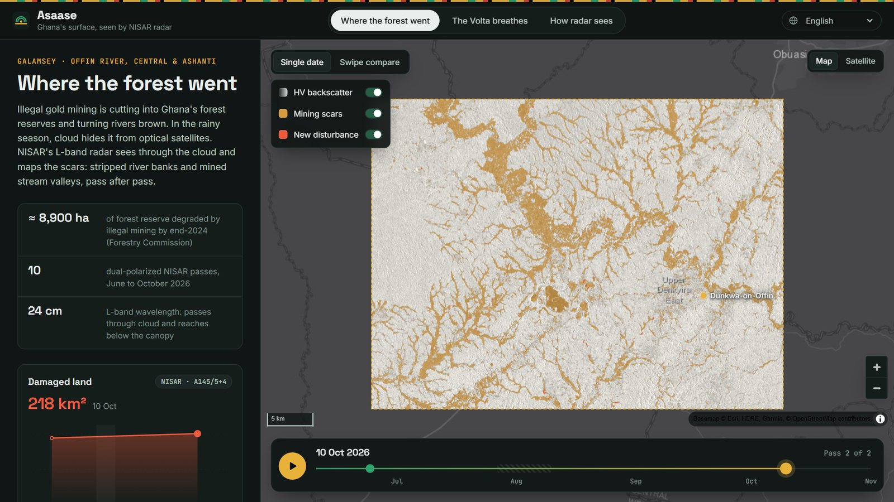

# Asaase

**Ghana's changing land and water, seen through cloud by NASA-ISRO NISAR radar.**

**Live app: [asaase.earth](https://asaase.earth)**

*Asaase* means "earth" in Twi. This is our entry for the NASA Space Apps Challenge 2026,
[Dancing with the SARs](https://www.spaceappschallenge.org/2026/challenges/dancing-with-the-sars/).



## The problem

From April to October, cloud covers southern Ghana. That is exactly when illegal gold mining
(*galamsey*) spreads along rivers and forest reserves, and when the White Volta floods. Optical
satellites cannot see the ground through cloud, so the damage goes unmapped when it matters most.
NISAR's L-band radar sends its own signal and sees through cloud, day and night, every 12 days.

## Two stories, one app

| Story | Where | What the radar shows |
| --- | --- | --- |
| **Where the forest went** | Offin River, Upper Denkyira East (galamsey belt) | Mining scars: stripped ground and pits are dark in HV radar, where intact forest is bright. About 141–175 km² on every pass, June to October 2026 |
| **The Volta breathes** | White Volta, Pwalugu to Daboya | The flood from the late-August 2026 Bagré Dam spill: water under vegetation rises to 10.7 km² on 21 Sep and is gone by late October |

Plus **How radar sees**, a plain-language explainer of mirror, canopy and double-bounce scattering.

In the app you can:

- step through every NISAR pass on a timeline, or play it as an animation;
- **swipe** between two dates to compare them side by side;
- switch between the radar and satellite photos to check what the radar found;
- read the area affected on each pass in a chart, or **listen** to it as a rhythm;
- see **how many people live near the flood water** on each pass, and which settlements;
- **click any spot** to see its radar history over every pass, with a plain-language reading;
- see **forest reserves** and how much of each is scarred, and the licensed Edikan mine kept apart from galamsey;
- **share** the current view as an image (WhatsApp-ready on phones);
- switch between **light and dark** mode.

Real NISAR data, no server: the app is a static site that loads fast on mobile data.

## How it works

```
NISAR GCOV (ASF)  →  Python pipeline  →  map layers + story.json  →  web app
HH + HV, 12-day      mosaic, de-speckle,   transparent PNGs and       React, MapLibre,
repeat, via ASF      detect change         numbers per pass           static hosting
```

The method, study areas, tracks, results so far and what we are still checking are in
[docs/METHODS.md](docs/METHODS.md).

## How we know

We checked both stories against independent data (details in [docs/METHODS.md](docs/METHODS.md)):

- **Galamsey:** 75% of the mining scars NISAR finds were forest in 2000, according to Global Forest Watch's
  Landsat-based tree-cover maps. The forest loss that map records inside the scars rose, dipped and surged
  again (2014–2017, 2018–2021, 2022–2023) exactly as our Sentinel-1 series does.
- **Floods:** Sentinel-1, a different radar, also brightens where NISAR found flooding in mid-September:
  26% of those places brightened by 3 dB or more in VV, against 1.8% of the land around them.
- **Thresholds** were tuned against satellite photos and tested for sensitivity; the flood peaks on
  21 September whichever reasonable threshold is used.

## Repository layout

```
asaase/
├── web/        React + TypeScript + MapLibre app (static; live at asaase.earth on Cloudflare Pages)
│   └── public/data/<story>/   processed radar layers and story.json, written by the pipeline
├── pipeline/   Python: find, download and process NISAR GCOV into web layers
├── data/       Local downloads and intermediates (git-ignored; raw files are several GB each)
└── docs/
    └── METHODS.md   Data, method, results and limitations
```

## Quick start: web app

Needs Node 18 or newer.

```bash
cd web
npm install
npm run dev        # http://localhost:5173
```

## Quick start: data pipeline

Needs Python 3.10 or newer.

```bash
cd pipeline
python -m venv .venv
.venv/Scripts/activate          # Windows (macOS/Linux: source .venv/bin/activate)
pip install -e ".[dev]"
pytest -q

asaase search floods                     # list scenes, no login needed
asaase download floods --main-track-only # needs a NASA Earthdata login
asaase quicklook floods                  # before / after / difference PNG in data/work/
asaase build floods                      # writes web/public/data/floods/
```

Downloading needs a free [NASA Earthdata](https://urs.earthdata.nasa.gov/) account. Put your
login in `~/.netrc` (Windows: `%USERPROFILE%\_netrc`):

```
machine urs.earthdata.nasa.gov login YOUR_USERNAME password YOUR_PASSWORD
```

Never commit credentials: `.gitignore` excludes `.netrc`, `.env` and all `.h5` files.

## Data and credits

**NASA data at the core.** Both stories are built on NISAR, the NASA–ISRO L-band radar mission: Level-2
GCOV backscatter for every pass June–October 2026 and GUNW interferometric products, distributed by
NASA's Alaska Satellite Facility DAAC through NASA Earthdata. The forest-loss check also rests on NASA/USGS
Landsat, through Global Forest Watch.


- NISAR L-band products: NASA/JPL-Caltech and ISRO, distributed by the
  [ASF DAAC](https://nisar-docs.asf.alaska.edu/).
- Basemaps: Esri (Dark Gray Canvas, World Imagery).
- Sentinel-1 (Copernicus, ESA), terrain-corrected, via [Microsoft Planetary Computer](https://planetarycomputer.microsoft.com/dataset/sentinel-1-rtc).
- Population: [WorldPop](https://www.worldpop.org/) 2020, Ghana, constrained, 100 m (CC BY 4.0).
- Settlements, forest-reserve and mine outlines: © [OpenStreetMap](https://www.openstreetmap.org/copyright) contributors (ODbL).
- News and context sources are listed in each story's panel.

## Licence

MIT (see `LICENSE`).
